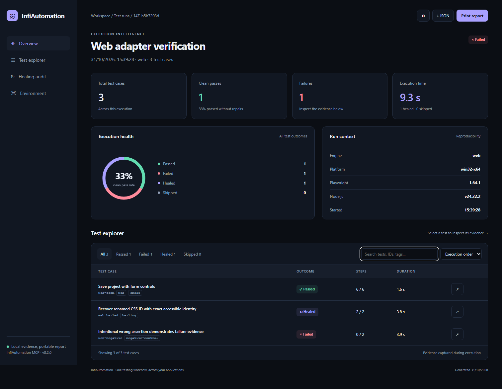

# InfiAutomation MCP

**One testing workflow for web, Electron, and Windows desktop applications.**

InfiAutomation connects an MCP-compatible AI client to real application controls, then turns a test plan into reusable tests and evidence-rich, offline HTML reports. It also runs saved suites directly from the command line.

- **Inspect:** browser accessibility snapshots, Windows UI Automation trees, multiple windows, native Electron menus, and bounded nested-menu discovery.
- **Plan and generate:** requirement-traced plans, validated JSON suites, portable JavaScript test runners, and planner/generator/healer MCP prompts.
- **Execute:** sequential cases with fresh sessions, explicit assertions, screenshots, and Playwright traces.
- **Heal with evidence:** opt-in, exact-identity selector recovery; locator-only patches with backups; no weakened assertions.
- **Report:** summary dashboard, searchable/filterable case explorer, step drill-down, evidence images, healing audit, environment details, JSON export, dark/light themes, and print layout. No CDN or report server required.

> **Scope:** Web and Electron use Playwright on its supported operating systems. Native desktop automation currently uses FlaUI on **Windows**. No framework can guarantee every app: inaccessible canvas controls, protected windows, disabled Electron inspect fuses, elevated apps, and locked desktops need app-specific setup or another adapter. Native macOS/Linux desktop apps are not supported in v0.2.



The verification fixture above deliberately includes one failing assertion and one healed selector to demonstrate truthful reporting.

## Install and connect

InfiAutomation MCP is packaged as **`@infiautomation/mcp`**. npm requires lowercase package names; the product/repository name remains InfiAutomation MCP.

> **npm publication pending:** the short registry command below becomes available after the maintainer's first npm publish. Until then, use the working [GitHub release configuration](examples/mcp.github.json) and setup command below. No npm account is needed to consume the GitHub release.

After npm publication, clients accepting `mcpServers` can use:

```json
{
  "mcpServers": {
    "infiautomation": {
      "command": "npx",
      "args": [
        "--yes",
        "@infiautomation/mcp@latest"
      ]
    }
  }
}
```

Install **Node.js 24 LTS or newer** on the same machine as the app, then run one-time setup with the same launcher:

```sh
# After npm publication:
npx --yes @infiautomation/mcp@latest setup
# Add Windows native support:
npx --yes @infiautomation/mcp@latest setup --desktop
```

**Available from GitHub without npm publication:**

```sh
npx --yes https://github.com/warademilind/InfiAutomation-mcp/releases/download/v0.2.0/infiautomation-mcp-0.2.0.tgz setup
# On Windows, add --desktop to install the native worker too.
```

Use [examples/mcp.github.json](examples/mcp.github.json) to connect through that release. It uses `npx` and a public package URL, without cloning, Git, a source build, or an executable path. The first installation needs internet; startup never silently installs browsers or native workers. Use the same version for setup and the MCP launcher. For reproducibility, replace `@latest` with a released package version after npm publication.

Restart/reload the MCP client, enable InfiAutomation tools, then ask it to call `doctor`. Configuration wrappers differ by client: [general npm JSON](examples/mcp.npx.json), [Codex TOML](examples/codex.npx.toml), and [VS Code servers-style JSON](examples/vscode.npx.json). In those files, replace the npm package argument with the GitHub tarball URL until npm publication. Newer VS Code versions accepting `.mcp.json` can use the general JSON. Local checkout configurations are also available in [mcp-clients.json](examples/mcp-clients.json).

### Platform support and prerequisites

| Capability | Windows | macOS | Linux |
| --- | --- | --- | --- |
| Web testing with Playwright | Yes | Yes | Yes |
| Electron renderer testing | Yes, supported Electron apps | Yes, supported Electron apps | Yes, supported Electron apps |
| Native desktop via FlaUI/UIA3 | Yes; interactive desktop | No native adapter yet | No native adapter yet |
| Plans, suite generation, healing, HTML reports | Yes | Yes | Yes |

Use Playwright-supported operating systems and an app exposing usable controls. Native desktop testing requires the **.NET 8 Windows Desktop Runtime**, the same privilege level as the target, and a signed-in, unlocked Windows desktop. Prebuilt x64 and ARM64 workers are provided; ARM64 is cross-built and requires validation on ARM64 hardware. Setup verifies the release SHA-256 checksum before caching the worker. It does not install .NET. Building from source additionally requires the .NET 8 SDK.

Run `setup --desktop --skip-browser` for desktop-only testing. On Linux, `setup --with-deps` also asks Playwright to install OS browser dependencies and may require elevated package-manager permissions. Electron targets need their app executable/CDP endpoint and a display server where required. No automation framework can execute every app on every machine.

By default, plans, suites and reports use the client's working directory. System folders, drive roots, or unwritable folders fall back to `~/InfiAutomation`. Append `"--workspace", "/absolute/path/your-test-project"` to `args`, or set `INFIAUTOMATION_WORKSPACE` to choose a project. Windows JSON paths need doubled backslashes, such as `D:\\tests`. Run the launcher with `doctor` to inspect the effective workspace, browser installation, and desktop runtime.

### Develop from source

Install Node.js 24 and Git, then:

```sh
git clone https://github.com/warademilind/InfiAutomation-mcp.git
cd infiautomation-mcp
npm ci
npm run build
node dist/cli.js setup
node dist/cli.js run examples/web.suite.json
```

The source example uses a self-contained HTML fixture. Open the reported `index.html` for the summary and `detailed.html` for the test explorer. From a checkout, native source builds additionally need the **.NET 8 SDK**: run `npm run build:native`. The worker uses FlaUI 5.0.0 with pinned NuGet dependencies. For custom worker locations set `INFIAUTOMATION_NATIVE_WORKER` to the DLL's absolute path.

**GitHub hosts source and downloadable builds; automation runs locally beside the app under test.** Native desktop automation needs the same privilege level as its target. Attach with `pid` or a unique `windowTitle`, or launch an `executable`. Attached native applications are left open. One native session per Windows desktop is supported.

## Use it with an AI client

Ask the connected client:

> Inspect this application. Build a test plan for its project form, including validation and recovery cases. Save a reusable suite, execute it, and give me the summary and detailed HTML reports. Preserve assertions when proposing selector repairs.

The included `test-planner`, `test-generator`, and `test-healer` prompts guide the host model. Planning and generation are authored by that model and validated/persisted by InfiAutomation; there is no hidden LLM service, required API key, or claim that a template independently understands arbitrary business rules.

Typical sequence:

```text
session_start → ui_snapshot / ui_menus → plan_create → test_generate
                                                    ↓
                                              test_run → test_status → report_get
                                                    ↓
                                       heal_suggest → heal_apply → rerun
```

Long suites run as background jobs inside the MCP process; `test_run` returns a job ID immediately. Keep the client/server alive and poll `test_status`. CLI execution waits and exits nonzero for failed cases. Healed cases are a separate outcome.

## A test is a portable document

```json
{
  "schemaVersion": 1,
  "name": "Project form",
  "target": { "kind": "web", "url": "http://localhost:3000" },
  "healing": "off",
  "tests": [{
    "id": "project-save",
    "name": "Save a project",
    "requirements": ["R01"],
    "tags": ["smoke"],
    "steps": [
      { "name": "Name", "action": "fill", "locator": { "label": "Project name" }, "value": "Launch" },
      { "name": "Save", "action": "click", "locator": { "role": "button", "name": "Save project" } },
      { "name": "Verify", "action": "assertText", "locator": { "testId": "status" }, "value": "Saved Launch" }
    ]
  }]
}
```

For Electron, set `kind: "electron"` and `executable` plus optional `args`, or supply an existing Chromium `cdpUrl`. Native Electron menu reading requires launch mode; CDP-only connections expose renderer menus. Playwright's Electron API remains experimental.

For Windows native apps use `kind: "desktop"` and `executable`, `pid`, or `windowTitle`. Locators use `automationId`, `controlType`, `name`, and optional `windowTitle`. See [examples](examples/) and [tool/action reference](docs/API.md).

## Honest healing and honest results

Healing defaults to **off**. `semantic` mode retries only a locator that resolved to **zero controls before the action**, using a unique exact accessible name and compatible role/control type. It never retries a failed assertion, fuzzy-matches a nearby button, or blindly repeats a partially completed action. Every repair appears in the report.

`heal_apply` previews by default; `apply: true` writes a locator-only patch, backup and audit record. Assertion steps cannot be patched. A patch is unverified until the test is rerun.

Menu discovery reads actual runtime controls. It never substitutes a predefined menu list. UIA discovery expands supported submenu containers, collapses what it opened, and never invokes leaf commands. Lazy/non-accessible menus may require explicit navigation; truncated trees and discovery errors are reported.

## GitHub automation

The repository includes:

- Linux/Windows/macOS Node build and unit/protocol checks.
- Chromium and Electron fixture integration on Linux.
- Compilation of the Windows worker on a Windows runner.
- An opt-in native fixture workflow for a **self-hosted interactive Windows runner**.
- Tag-driven releases with npm-format tarball, native Windows worker, and SHA-256 checksums.

See [CI and release guide](docs/CI.md). Native UI automation is not claimed to work on GitHub-hosted unattended Windows desktops. GitHub Pages can host a deliberately sanitized report; InfiAutomation does not upload private test artifacts automatically.

## Develop and verify

```sh
npm ci
npm run build
npm test
npx playwright install chromium
npm ci --prefix integration/fixtures/electron
npm run test:integration:web
npm run test:integration:electron
```

On Windows with .NET 8+, build the worker and native fixture, then run `npm run test:integration:native`. See [CONTRIBUTING.md](CONTRIBUTING.md).

Reports and screenshots stay under `.infiautomation/` and are ignored by Git. The browser and target application can still access the network. Executable paths and actions are trusted local-user inputs; connect only a trusted MCP client. See [SECURITY.md](SECURITY.md).

## Upstream foundations

| Component | Pinned version | Source |
| --- | --- | --- |
| Playwright | 1.64.1 | [Microsoft Playwright](https://github.com/microsoft/playwright) |
| FlaUI UIA3 | 5.0.0 | [FlaUI](https://github.com/FlaUI/FlaUI) |
| MCP TypeScript server/client SDK | 2.4.0 | [MCP SDK](https://github.com/modelcontextprotocol/typescript-sdk) |
| Zod | 4.6.7 | [Zod](https://github.com/colinhacks/zod) |

Versions were checked on 31 October 2026 and are locked in package/restore lockfiles. Dependencies are used through their public APIs, with upstream attribution in [THIRD_PARTY_NOTICES.md](THIRD_PARTY_NOTICES.md).

MIT licensed. Independent project; not affiliated with Microsoft, FlaUI, or the MCP maintainers.

For package publication and repository review settings, see [PUBLISHING.md](docs/PUBLISHING.md).
